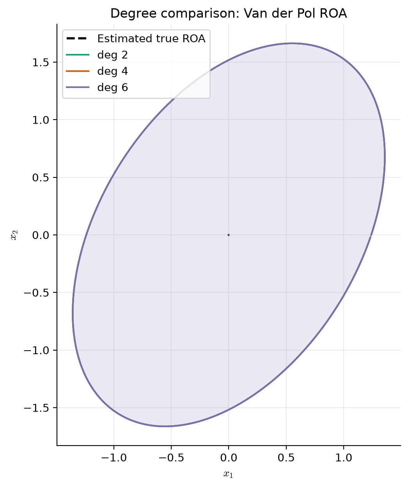
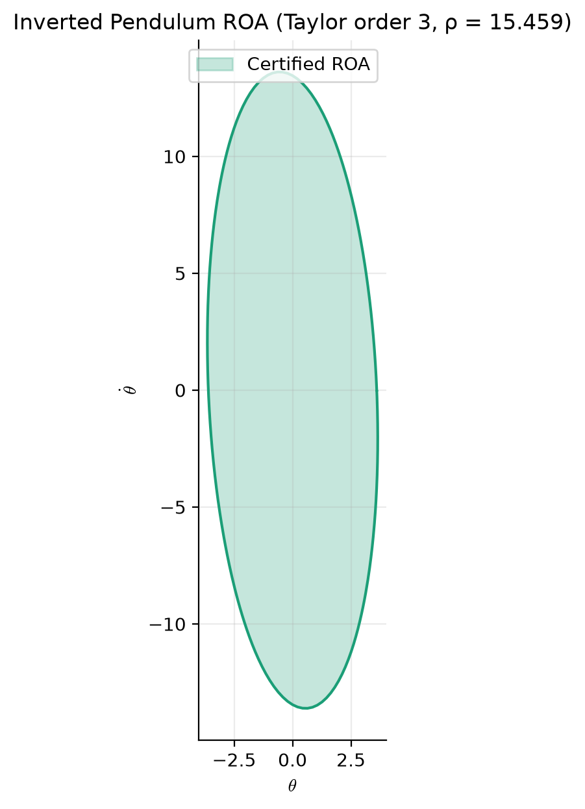
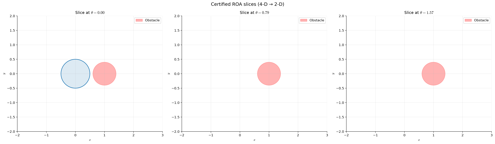
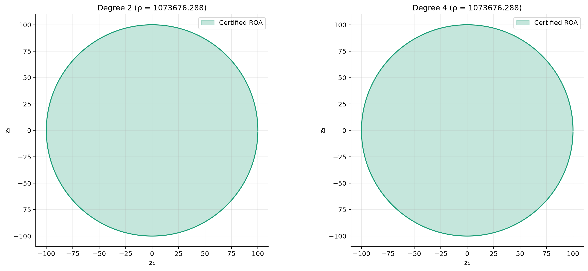

# lyapunov-toolbox

Sum-of-Squares Lyapunov function synthesis and region-of-attraction estimation in
Julia (SumOfSquares.jl), Python (bridge + plotting), and MATLAB (YALMIP+Mosek).

[](https://github.com/ali-eiman/lyapunov-toolbox/actions/workflows/test.yml)
[](https://julialang.org)
[](LICENSE)

> **Status: pre-release.** All six benchmark configurations now synthesise and
> verify (algebraic + sampling + dynamical checks), and the obstacle-free claim is
> backed by an explicit containment constraint rather than asserted. Still open
> before a tagged release, tracked in [REVIEW.md](REVIEW.md): `docs/benchmarks.md`
> and the Results table below are unfilled, the notebooks have not been executed
> with outputs, the MATLAB cross-validation fixture has not been generated, and
> two tests have stale expectations. Numeric results are deliberately absent here
> rather than quoted from an unverified run.

<table>
<tr>
  <td align="center" width="50%">
    <br>
    <strong>Van der Pol (reversed)</strong><br>
    <em>Certified sublevel set against the exact limit-cycle boundary</em>
  </td>
  <td align="center" width="50%">
    <br>
    <strong>Inverted pendulum</strong><br>
    <em>Taylor and exact trigonometric recastings compared</em>
  </td>
</tr>
<tr>
  <td align="center" width="50%">
    <br>
    <strong>Unicycle + obstacle</strong><br>
    <em>Constrained certificate via Putinar multipliers</em>
  </td>
  <td align="center" width="50%">
    <br>
    <strong>Multi-agent consensus</strong><br>
    <em>Certified set in disagreement coordinates</em>
  </td>
</tr>
</table>

## What this does

This toolbox synthesises **Lyapunov functions** for polynomial (and
polynomially-recast) nonlinear systems using sum-of-squares programming.
For a polynomial vector field $\dot x = f(x)$ with a locally asymptotically
stable equilibrium $x_\mathrm{eq}$, it produces:

1. a polynomial Lyapunov function $V(x)$ vanishing at $x_\mathrm{eq}$,
2. a certified sublevel set $\Omega_\rho = \{x : V(x) \le \rho\}$ that is
   positively invariant and contained in the true region of attraction,
3. the Gram matrices and SOS multiplier certificates that let a third party
   **re-verify** the result without re-solving the SDP.

The third item is the point. A certified level with no witness cannot be audited
or composed; a certificate that carries its own Gram matrices can be checked by
anyone with a linear-algebra library and no solver at all.

It is written for researchers who need inner approximations of ROAs as building
blocks for larger analysis problems (compositional stability of hybrid systems,
transition-viable funnels, safety verification).

## What is implemented

| Capability | Julia | MATLAB | Python |
|---|---|---|---|
| Fixed-$V$ $\rho$-bisection | ✅ | ✅ | via bridge |
| $V$–$s$ iteration | ✅ | — | via bridge |
| Shape-set expansion ($\beta$-step) | ✅ | — | via bridge |
| Putinar constraints (obstacles, barriers) | ✅ | — | via bridge |
| Trigonometric recasting (pendulum, unicycle) | ✅ | — | via bridge |
| Certificate verification (Gram check) | ✅ | — | via bridge |
| Plotting (ROA, phase portrait, $\dot V$) | — | basic | ✅ |
| Save/load certificates (JSON) | — | — | ✅ |

The V–s iteration is Julia-side only, deliberately: `matlab/compute_roa_yalmip.m`
is an *independent* implementation of the fixed-$V$ program against a different
modelling layer and a different solver, and its value is that it shares no code
with the Julia side. Making the two feature-equivalent would remove the only
cross-check the repository has.

## Install

```bash
git clone https://github.com/ali-eiman/lyapunov-toolbox.git
cd lyapunov-toolbox
```

```bash
julia --project=julia -e 'using Pkg; Pkg.instantiate()'
```

```bash
pip install -e python
```

The Python bridge resolves the Julia project relative to the installed package,
so no environment variable is needed for a normal checkout. To point it at a
different one, set `LYAPUNOV_TOOLBOX_JULIA_PROJECT` (an absolute path to the
`julia/` directory) and, optionally, `LYAPUNOV_TOOLBOX_BRIDGE` to `juliacall`
(default) or `pyjulia`.

MATLAB is optional and used only for cross-validation; it needs YALMIP plus one
SDP solver (Mosek, or SeDuMi if you have no Mosek licence).

## Quickstart

```python
from lyapunov_toolbox import certify_roa

# Reversed Van der Pol: the canonical ROA benchmark.
cert = certify_roa(
    ["-x2", "x1 + (x1^2 - 1)*x2"],
    variables=("x1", "x2"),
    V_degree=4,
)

print(f"certified rho = {cert.rho:.4f}")
print(f"V has degree {cert.degree} in {cert.n_vars} variables")
print(f"bounded via {cert.boundedness_evidence}; verified = {cert.verified}")

cert.save("vdp_cert.json")
```

`certify_roa` returns a `RoaCertificate` — a frozen, picklable, JSON-serialisable
value object holding no live Julia handle, so it can be evaluated, plotted, and
stored on a machine with no Julia installed. Use `synthesize("van_der_pol", ...)`
instead to run the full V–s iteration on one of the four built-in benchmark
systems; it returns `(certificate, history)`.

## Results

All six configurations synthesise **and** verify — algebraic (Gram residual
against the reconstructed target), sampling (`V̇ < 0` pointwise, on the invariant
manifold where one exists), and dynamical (forward simulation). Full table,
environment, and caveats in [`docs/benchmarks.md`](docs/benchmarks.md).

| System | `n` | `deg V` | `ρ` | Certified volume | Gram block | Verified |
|---|---|---|---|---|---|---|
| Van der Pol (reversed) | 2 | 2 | 2.304 | 6.496 | 6 | ✓ |
| Inverted pendulum (Taylor-3) | 2 | 2 | 1.0 | 164.9 | 6 | ✓ |
| Inverted pendulum (exact trig recast) | 3 | 2 | 4.000 | 106.9 | 20 | ✓ |
| Unicycle + obstacle | 4 | 2 | 1.0 | 0.5324 | 15 | ✓ |
| 3-agent consensus (disagreement coords) | 2 | 2 | 1.0 | 109.3 | 6 | ✓ |

**`ρ` is not comparable across rows** — `v_s_iteration` normalises to `ρ ≡ 1`
when its refinement improves on the fixed-V baseline and leaves the unnormalised
level when it does not. The comparable quantity is the certified **volume**, and
even that only within a system: the state spaces differ in dimension and units.

Two results worth stating plainly rather than burying:

- Requesting `V_degree = 4` on Van der Pol returns a **degree-2** certificate,
  because the degree-4 iterate enclosed less (6.4675 vs 6.496). The V-step
  maximises the inscribed shape-set level `β`, which for an anisotropic set is
  not the same as maximising volume. A richer basis is not guaranteed to help.
- The unicycle certifies a small set (volume 0.53) because it must clear the
  obstacle: the program imposes `{V ≤ ρ} ⊆ {g ≥ 0}` explicitly, so the certified
  region is genuinely obstacle-free (measured minimum clearance 0.106 m over
  300 000 on-manifold samples) rather than merely conditional on starting
  outside it.

There is no "fraction of true ROA" column yet — that needs the ground-truth
boundary sweep, which has not been run.

## Examples

| Example | Julia script | Notebook |
|---|---|---|
| Van der Pol oscillator | [`van_der_pol_demo.jl`](examples/van_der_pol/van_der_pol_demo.jl) | [`van_der_pol_demo.ipynb`](examples/van_der_pol/van_der_pol_demo.ipynb) |
| Inverted pendulum (trig + Taylor) | [`inverted_pendulum_demo.jl`](examples/inverted_pendulum/inverted_pendulum_demo.jl) | [`inverted_pendulum_demo.ipynb`](examples/inverted_pendulum/inverted_pendulum_demo.ipynb) |
| Unicycle with circular obstacle | [`unicycle_demo.jl`](examples/unicycle_with_obstacle/unicycle_demo.jl) | [`unicycle_demo.ipynb`](examples/unicycle_with_obstacle/unicycle_demo.ipynb) |
| Multi-agent consensus (adversarial switching) | [`consensus_demo.jl`](examples/multi_agent_consensus/consensus_demo.jl) | [`consensus_demo.ipynb`](examples/multi_agent_consensus/consensus_demo.ipynb) |

The `.jl` scripts do the computation and exit non-zero on a failed assertion; the
notebooks read their output and do the plotting and the prose. The notebooks are
currently unwritten (REVIEW.md R1-5).

## Theory

- **[`docs/theory_notes.md`](docs/theory_notes.md)** — notation mapped to code
  identifiers, Lyapunov's direct method and the ROA corollary, the SOS
  parameterisation, the $\mathcal{S}$-procedure, Putinar certificates, ROA
  computation, recasting, and numerical conditioning.
- **[`docs/derivations/sos_decomposition.tex`](docs/derivations/sos_decomposition.tex)** —
  the Gram matrix parameterisation with a fully worked hand example, Motzkin's
  nonnegative-but-not-SOS polynomial, and the numerical caveats.
- **`docs/derivations/positivstellensatz.tex`** — Putinar's Positivstellensatz,
  the $\mathcal{S}$-procedure specialisation, the V–s iteration, and the forward
  connection to transition-viable funnels. **Not yet written** — the file is
  currently a copy of `sos_decomposition.tex` (REVIEW.md R1-4).

Compile the derivations with `latexmk -pdf` from inside `docs/derivations/`. The
PDFs are build artifacts and are not committed.

## What this does not do

- **Inner approximations only.** Nothing here provides an outer bound on the ROA;
  the true region may be much larger than the certified set. For outer
  approximations, see the occupation-measure approach of Henrion & Korda.
- **No exact certificates.** All results are floating-point. Rational rounding
  (Peyrl–Parrilo, Powers–Wörmann) is not implemented, so a certificate holds to
  the stated Gram residual, not exactly.
- **No robustness guarantees.** There is no robust or common-Lyapunov formulation
  in this codebase; additive disturbance, parameter mismatch, and model error all
  invalidate the certificates.
- **Infeasibility proves nothing.** Putinar's theorem gives no degree bound on the
  multipliers, so an infeasible program means no certificate exists *at this
  degree, in this basis, with this multiplier structure* — not that none exists.
- **The V–s iteration is a local heuristic.** It is monotone in $\beta$ by
  construction but has no convergence guarantee to a global optimum, and different
  seeds reach different fixed points.
- **Degree and dimension limits.** The Gram dimension is $\binom{n+d}{d}$ and the
  monomial basis becomes ill-conditioned well before it becomes large. The
  measured wall belongs in `docs/benchmarks.md` §2 and is not stated here until it
  has been measured.
- **A Taylor-recast certificate is about the truncated field**, not the original
  system. No truncation-error bound is computed; the pendulum example measures the
  gap empirically instead and reports where it opens.
- **Continuous-time only.** Discrete-time Lyapunov analysis is not implemented.

Naming the limits is what makes the claims above credible.

## Citing

This library produces the per-mode inner approximations that compose into
transition-viable funnels. To cite it in a paper:

> The SOS certificates and sublevel-set estimates were computed with
> `lyapunov-toolbox` (commit `abcdef`, https://github.com/ali-eiman/lyapunov-toolbox),
> which wraps SumOfSquares.jl with Clarabel.

Replace `abcdef` with the commit actually used. Pin the commit rather than the
version — `julia/Manifest.toml` is committed, so a pinned commit reproduces the
exact solver stack.

## References

1. P. A. Parrilo, *Structured Semidefinite Programs and Semialgebraic Geometry
   Methods in Robustness and Optimization*, Ph.D. thesis, Caltech, 2000.
2. M. Putinar, "Positive polynomials on compact semi-algebraic sets," *Indiana
   Univ. Math. J.*, vol. 42, no. 3, pp. 969–984, 1993.
3. Z. Jarvis-Wloszek, R. Feeley, W. Tan, K. Sun, and A. Packard, "Some controls
   applications of sum of squares programming," in *Proc. IEEE CDC*, 2003.
4. U. Topcu, A. Packard, and P. Seiler, "Local stability analysis using
   simulations and sum-of-squares programming," *Automatica*, vol. 44, no. 10,
   2008.
5. H. K. Khalil, *Nonlinear Systems*, 3rd ed., Prentice Hall, 2002.
6. G. Blekherman, P. A. Parrilo, and R. R. Thomas (eds.), *Semidefinite
   Optimization and Convex Algebraic Geometry*, SIAM, 2013.
7. D. Henrion and M. Korda, "Convex computation of the region of attraction of
   polynomial control systems," *IEEE Trans. Autom. Control*, vol. 59, no. 2, 2014.
8. J. Löfberg, "YALMIP: A toolbox for modeling and optimization in MATLAB," in
   *Proc. CACSD*, 2004.

## Licence

BSD 3-Clause — see [LICENSE](LICENSE).
